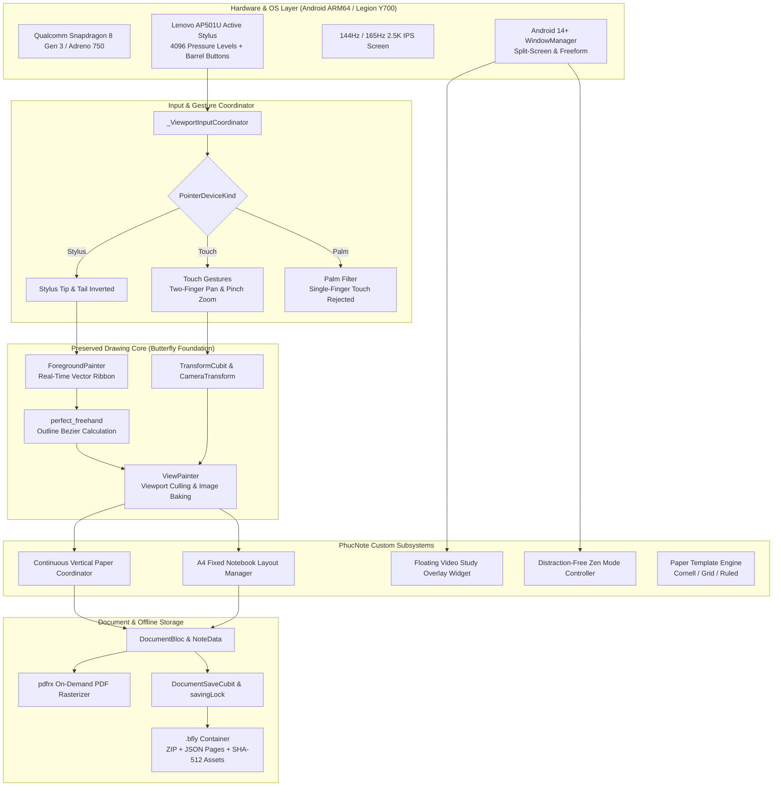

# PhucNote — System Architecture & Design Specification

**Project:** PhucNote  
**Repository:** [https://github.com/Phuchello/PHUCNOTE](https://github.com/Phuchello/PHUCNOTE)  
**Target Hardware:** Lenovo Legion Y700 Gen 4 (Snapdragon 8 Gen 3, 144Hz/165Hz, Android ARM64)  
**Input Hardware:** Lenovo AP501U Active Stylus (4096 pressure levels, active digitizer)  
**Development Host:** Lenovo ThinkPad X250 (Ubuntu Linux, 8GB RAM, Core i5-5200U)  

---

## 1. High-Level Architectural Overview

PhucNote is built on Flutter with a layered, reactive BLoC/Cubit architecture. It maintains strict separation between hardware input capture, transient in-progress stroke rendering, viewport culling, and atomic document persistence.



---

## 2. Strategic Strategy: Upstream Fork vs. Independent Core Foundation

To establish the official repository at [Phuchello/PHUCNOTE](https://github.com/Phuchello/PHUCNOTE), we conducted a technical trade-off evaluation:

### Option A: Direct Git Remote Fork of Butterfly
- **Mechanism:** Maintain `LinwoodDev/Butterfly` as git upstream remote and layer commits on top.
- **Drawbacks:**
  - Carries upstream git history (~10,000+ commits), legacy build scripts for macOS DMG, Windows MSIX, Snapcraft, and Web workers.
  - Frequent breakage from upstream internal package refactoring (`dart_pkgs`, `Swamp`, `material_leap`).
  - Difficult to strip proprietary Linwood branding and trademarks cleanly without merge conflicts.

### Option B: Independent Clean-Slate Repository with Audited Foundation (Selected)
- **Mechanism:** Initialize `Phuchello/PHUCNOTE` as an independent repository. Import and vendor the audited drawing engine, models, and `.bfly` serializer. Build a focused, tablet-first UI and dedicated Android modules directly on top.
- **Advantages:**
  - **Zero Legacy Bloat:** Strips non-Android desktop artifacts, shrinking repository size and build times.
  - **Full Architectural Autonomy:** Clean slate to implement the Continuous Vertical Paper and Floating Video Study workflows without fighting desktop layout constraints.
  - **Pristine AGPL-3.0 Compliance:** Distinct product identity under custom branding while crediting Linwood under AGPL-3.0.
  - **Optimized for ThinkPad X250:** Compact codebase enables fast compilation within 8GB RAM constraints.

---

## 3. ThinkPad X250 Development Host Constraints & Mitigations

The development host is a **Lenovo ThinkPad X250** running Ubuntu Linux:
- **Processor:** Intel Core i5-5200U @ 2.20GHz (2 physical cores, 4 threads).
- **RAM:** 8 GB DDR3L (~7.1 GiB usable, ~3.0 GiB available).
- **Storage:** 120GB SSD (~55 GB available).
- **Compilation Constraints:**
  - Full Android Gradle builds combined with Dart `build_runner` code generation can easily exceed 4GB memory, inducing heavy swap trashing and thermal throttling.
- **Host Mitigations:**
  1. Constrain Gradle daemon memory in `gradle.properties`:
     ```properties
     org.gradle.jvmargs=-Xmx2048m -XX:MaxMetaspaceSize=512m -XX:+UseParallelGC
     org.gradle.parallel=false
     org.gradle.vfs.watch=false
     ```
  2. Minimize concurrent build threads (`--max-workers=2`).
  3. Pre-generate Freezed and JSON serializable classes during milestones rather than running continuous file watchers.
  4. Perform incremental builds focused on `android-arm64` APK artifacts.

---

## 4. Subsystem Design Specifications

### 4.1 Inking & Latency Pipeline
- **Foreground Fast Path:** Ongoing strokes are gathered in `PenHandler` and immediately pushed to `ForegroundPainter`. They bypass the main canvas tree and render directly to the active hardware-accelerated Skia/Impeller canvas.
- **Smoothing & Outline Construction:**
  - Points are collected as `PathPoint(x, y, pressure, tilt)`.
  - Fed into `freehand.getStroke()` with `streamline` (0.45) and `smoothing` (0.55) to eliminate hand tremor while maintaining sharp corners.
  - Outlines are joined with quadratic Bezier curves and filled with `Paint(isAntiAlias: true)`.
- **Viewport Baking:** Once the stylus lifts (`onPointerUp`), after a debounce timer, strokes are baked into an off-screen bitmap tile (`cameraViewport.image`). During subsequent panning or zooming, only the lightweight raster tile is transformed until high-res settling occurs.

### 4.2 Stylus & Palm Rejection (Lenovo AP501U)
- The AP501U active digitizer transmits distinct hardware signals:
  - Stylus proximity triggers hover events before the tip touches the glass.
  - The digitizer reports `PointerDeviceKind.stylus` with hardware pressure (0 to 4096).
  - Barrel buttons report button bitmasks (`kSecondaryMouseButton`, etc.).
- **Rejection Logic:**
  ```dart
  if (penOnlyInputActive && event.kind == PointerDeviceKind.touch) {
    if (activePointerCount == 1) {
      // Discard single-finger touch as palm contact
      return;
    }
  }
  ```
  Two-finger touches are recognized by the gesture recognizer as navigation events (`TransformCubit.moveConstrained` and `zoomConstrained`).

### 4.3 Canvas Modes Architecture
1. **Infinite 2D Canvas:** Utilizes Butterfly's native `CameraTransform` coordinate space ($[x, y, \text{scale}, \text{rotation}]$).
2. **Infinite Vertical Paper:**
   - Pages are stacked sequentially along the $Y$ axis: $\text{Page}_n.y = \text{Page}_{n-1}.y + \text{PageHeight} + \text{Margin}$.
   - Horizontal scrolling is constrained to the paper width, providing a stable, notebook-like column.
   - Touching near the bottom boundary triggers dynamic page expansion.
3. **Standard A4 Notebook Mode:**
   - Viewport is constrained to an A4 ratio ($1 : \sqrt{2}$).
   - Paging navigation transitions between discrete pages with thumbnail index previews.

### 4.4 Floating Video Study Workflow
- Implemented as a top-level overlay in the editor `Stack`:
  ```dart
  Stack(
    children: [
      ViewportCanvas(),       // Drawing canvas
      FloatingVideoWidget(),  // Draggable picture-in-picture video
      FloatingToolbar(),      // Collapsible pen palette
    ],
  )
  ```
- Uses a `GestureDetector` with `HitTestBehavior.translucent` bounded strictly to the video pill. Stylus touches outside the video pill fall through cleanly to the canvas.
- Supports local video files (`video_player`) and YouTube / lecture streams.

### 4.5 Storage Engine & File Format
- File extension: `.bfly` (standard ZIP package).
- Internal hierarchy:
  - `meta.json`: Document name, created/updated timestamps, version header (`fileVersion: 2`).
  - `info.json`: Document preferences, thumbnail metadata, paper type.
  - `thumbnail.png`: 512×512 preview image.
  - `pages/0.page.json`, `pages/1.page.json`: Layer hierarchy and vector stroke arrays.
  - `assets/` (`images/`, `pdf/`, `textures/`): Stored by SHA-512 content hash to deduplicate binary assets.
- Persistence is handled by `DocumentSaveCubit` wrapping all writes in a mutex `savingLock.synchronized()` to prevent corruption.
