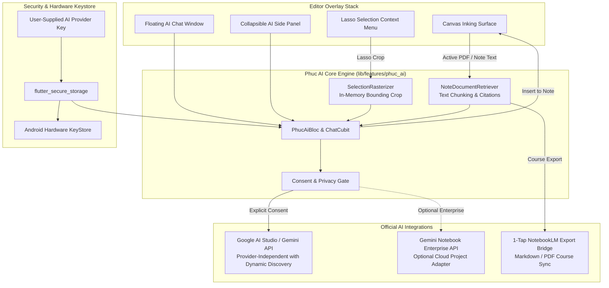
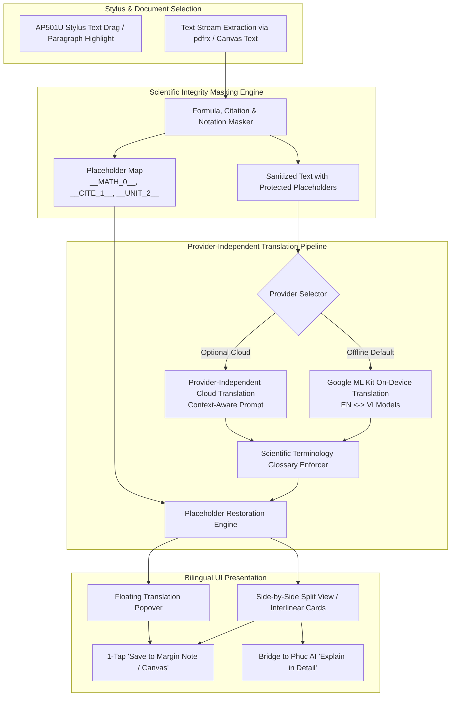

# PhucNote — System Architecture & Design Specification

**Project:** PhucNote  
**Repository:** [https://github.com/Phuchello/PHUCNOTE](https://github.com/Phuchello/PHUCNOTE)  
**Target Hardware:** Lenovo Legion Y700 Gen 4 (Snapdragon 8 Elite, up to 165Hz, Android ARM64)  
**Input Hardware:** Lenovo AP501U Active Stylus (Empirical MotionEvent/PointerEvent validation)  
**Development Host:** Lenovo ThinkPad X250 (Ubuntu Linux, 8GB RAM, Core i5-5200U)  

---

## 1. High-Level Architectural Overview

PhucNote is built on Flutter with a layered, reactive BLoC/Cubit architecture. It maintains strict separation between hardware input capture, transient in-progress stroke rendering, viewport culling, and atomic document persistence.


---

## 2. Strategic Strategy: Upstream Fork vs. Independent Core Foundation

To establish the official repository at [Phuchello/PHUCNOTE](https://github.com/Phuchello/PHUCNOTE), we conducted a technical trade-off evaluation:

### Option A: Direct Git Remote Fork of Butterfly
- **Mechanism:** Maintain `LinwoodDev/Butterfly` as git upstream remote and layer commits on top.
- **Drawbacks:**
  - Carries upstream git history (~10,000+ commits), legacy build scripts for macOS DMG, Windows MSIX, Snapcraft, and Web workers.
  - Frequent breakage from upstream internal package refactoring (`dart_pkgs`, `Swamp`, `material_leap`).
  - Difficult to strip proprietary Linwood branding and trademarks cleanly without merge conflicts.

### Option B: Independent Clean-Slate Repository with Audited Foundation (Selected)
- **Mechanism:** Initialize `Phuchello/PHUCNOTE` as an independent repository. Import and vendor the audited drawing engine, models, and `.bfly` serializer. Build a focused, tablet-first UI and dedicated Android modules directly on top.
- **Advantages:**
  - **Zero Legacy Bloat:** Strips non-Android desktop artifacts, shrinking repository size and build times.
  - **Full Architectural Autonomy:** Clean slate to implement the Continuous Vertical Paper and Floating Video Study workflows without fighting desktop layout constraints.
  - **Pristine AGPL-3.0 Compliance:** Distinct product identity under custom branding while crediting Linwood under AGPL-3.0.
  - **Optimized for ThinkPad X250:** Compact codebase enables fast compilation within 8GB RAM constraints.

---

## 3. ThinkPad X250 Development Host Constraints & Mitigations

The development host is a **Lenovo ThinkPad X250** running Ubuntu Linux:
- **Processor:** Intel Core i5-5200U @ 2.20GHz (2 physical cores, 4 threads).
- **RAM:** 8 GB DDR3L (~7.1 GiB usable, ~3.0 GiB available).
- **Storage:** 120GB SSD (~55 GB available).
- **Compilation Constraints:**
  - Full Android Gradle builds combined with Dart `build_runner` code generation can easily exceed 4GB memory, inducing heavy swap trashing and thermal throttling.
- **Host Mitigations:**
  1. Constrain Gradle daemon memory in `gradle.properties`:
     ```properties
     org.gradle.jvmargs=-Xmx2048m -XX:MaxMetaspaceSize=512m -XX:+UseParallelGC
     org.gradle.parallel=false
     org.gradle.vfs.watch=false
     ```
  2. Minimize concurrent build threads (`--max-workers=2`).
  3. Pre-generate Freezed and JSON serializable classes during milestones rather than running continuous file watchers.
  4. Perform incremental builds focused on `android-arm64` APK artifacts.

---

## 4. Subsystem Design Specifications

### 4.1 Drawing Engine & Latency Pipeline
- **Implementation Status:** The drawing engine in PHUCNOTE is an independent, lightweight custom Flutter implementation that faithfully replicates Linwood Butterfly's inking mathematics by utilizing `perfect_freehand` (the same core smoothing algorithm used by Butterfly's `PenRenderer`) paired with quadratic Bezier interpolation (`StrokeGeometry`), rather than importing Butterfly's complex `Renderer`/`TransformCubit`/`Bloc` monorepo components directly.
- **Dual-Layer Architecture:**
  - **Foreground In-Flight Layer (`PhucNoteForegroundPainter`):** Ongoing strokes are captured directly via `Listener` pointer events and rendered into a dynamic `RepaintBoundary` with `willChange: true` at display refresh rates (120–165Hz).
  - **Committed View Layer (`PhucNoteViewPainter`):** Completed strokes and paper background patterns are painted into an isolated `RepaintBoundary` with `isComplex: true` (raster caching), ensuring zero repaint overhead during steady state.
- **Smoothing & Outline Construction:**
  - Digitized points are collected as `StrokePoint(x, y, pressure, tilt)`.
  - Passed to `freehand.getStroke()` with `streamline` (0.40) and `smoothing` (0.55) to eliminate tremor while maintaining sharp vertex definition.
  - Outlines are transformed into smooth vector paths via quadratic Bezier interpolation (`quadraticBezierTo`) and rendered with anti-aliasing.

### 4.2 Stylus Input & Software Palm Rejection
- **Framework-Level Discrimination:**
  - Pointer events are inspected dynamically for `PointerDeviceKind.stylus` and `PointerDeviceKind.invertedStylus`.
  - Inverted stylus tips automatically route to the stroke eraser.
- **Configurable Stylus-Only Inking Mode:**
  - When enabled, `PointerDeviceKind.touch` events are strictly gated away from the inking engine and dedicated exclusively to smooth viewport panning.
  - When disabled, standard touch events are permitted to ink.
- **Software Palm Rejection Heuristics:**
  - Active stylus contact rejection: If a stylus is actively in contact with the screen (`_isStylusActive == true`), incoming touch events are rejected.
  - Contact area gating: Touch events exhibiting abnormal contact area (`event.size > 0.5` or `event.radiusMajor > 35 && event.radiusMinor > 25`) are rejected.
- **Hardware Disclaimer:** Software-level palm rejection is verified via automated widget and pointer tests. True hardware-level palm rejection and digitizer latency on the Lenovo Legion Y700 Gen 4 (Snapdragon 8 Elite) paired with the Lenovo AP501U active stylus cannot be claimed as verified without physical on-device empirical testing.

### 4.3 Action-History Undo / Redo Engine
- Replaces simplistic last-stroke popping with a complete Command/Action pattern (`CanvasAction`):
  - `AddStrokeAction`: Commits ink stroke; undo removes stroke; redo re-adds stroke.
  - `EraseStrokesAction`: Erases strokes and records their exact original indices; undo restores strokes back to their original z-order; redo re-erases them.
  - `ClearCanvasAction`: Clears canvas; undo restores all previous strokes; redo re-clears canvas.
- Maintains dedicated `_undoStack` and `_redoStack`, with new user mutations automatically clearing the redo stack.

### 4.4 Canvas Modes Architecture
1. **Infinite 2D Canvas:** Utilizes Butterfly-compatible coordinate space ($[x, y]$ translation).
2. **Infinite Vertical Paper:**
   - Pages are stacked sequentially along the $Y$ axis: $\text{Page}_n.y = \text{Page}_{n-1}.y + \text{PageHeight} + \text{Margin}$.
   - Horizontal scrolling is constrained to the paper width, providing a stable, notebook-like column.
3. **Standard A4 Notebook Mode:**
   - Viewport is constrained to an A4 ratio ($1 : \sqrt{2}$).
   - Paging navigation transitions between discrete pages with thumbnail index previews.

### 4.5 Storage Engine & File Format Compatibility
- **Archive Format:** `.bfly` (ZIP container) conforming to Linwood Butterfly v2.6.0 specification:
  - `META-INF/butterfly.json`: Metadata (`version: 2.6.0`, `fileVersion: 13`, `type: document`, `generator: PHUCNOTE`).
  - `META-INF/phucnote.json`: PHUCNOTE specific metadata.
  - `BFLY/info.json`: Document preferences, title, version, timestamps, paper template.
  - `BFLY/pages/0.Main.json`: Page layer hierarchy (`layers` -> `content`), `elements`, and vector stroke arrays.
- **Text & Legacy Format Support:** Full import interoperability with `.tbfly` and legacy single-file JSON `.bfly` documents, verified against actual upstream fixtures (`document_v1.bfly` and `study.tbfly`).
- **Atomic File Writes & Crash Recovery:**
  - All file saves are written to a temporary file (`.tmp_<timestamp>`) and flushed to disk before an atomic rename over the destination.
  - Previous file versions are preserved as `.bak` backup copies, allowing seamless automatic recovery if primary files are truncated or corrupted.
- **Reliable Autosave & Switch Guards:**
  - Automatic debounced autosave (1500ms inactivity timer).
  - Immediate lifecycle autosave flush upon `AppLifecycleState.paused`, `inactive`, or `detached`.
  - Unsaved modification warning dialogs and auto-save guards when creating new notes, switching documents, or exiting.

### 4.6 PHUC AI — Learning Assistant Extension Architecture

Phuc AI is designed as a completely decoupled, modular extension. It layers non-intrusively above the note canvas without coupling to the low-level rendering or serializer internals.



#### 4.6.1 Module Decoupling Strategy
- The extension resides in a dedicated package boundary (`lib/features/phuc_ai`).
- State is managed via `PhucAiBloc` and `ChatCubit`, keeping AI conversation history, streaming tokens, and prompt context completely isolated from `DocumentBloc` and `TransformCubit`.
- **Zero Impact on Inking:** Network I/O and streaming token decodes run asynchronously on background event loops; the inking thread on `ForegroundPainter` continues rendering at up to 165Hz without frame drops.

#### 4.6.2 Multimodal Handwriting Pipeline
1. When the student makes a lasso selection, the selection handler calculates the AABB rectangle ($[x_{\min}, y_{\min}, x_{\max}, y_{\max}]$) of selected `PenElement` paths.
2. `SelectionRasterizer` renders only the selected stroke paths to an in-memory `ui.Image` with transparent padding and encodes it as a PNG byte buffer (`Uint8List`).
3. The image is passed directly into the configured AI provider's multimodal vision API (`Content.data('image/png', bytes)`) with prompts such as:
   - *"Transcribe and explain this handwritten derivation step-by-step."*
   - *"Check this handwritten formula or proof for mathematical errors."*
4. No temporary image files are written to disk.

#### 4.6.3 Document Retrieval & Source Citations
- For course-wide and document Q&A:
  - Text from typed text elements, markdown blocks, and PDF text streams is extracted into lightweight text chunks tagged with source coordinates:
    `[Source: Lecture_04.pdf | Page: 7 | Section: Theorem 2.1]`
  - Chunks are assembled into the AI provider's context window or indexed via local cosine similarity embeddings.
  - Responses return structured markdown citations with clickable jumping links to navigate the canvas directly to the cited page.

#### 4.6.4 Security, Consent & BYOK (Bring Your Own Key) Architecture
- **No Shared API Secrets:** The application binary contains zero hardcoded API keys.
- **BYOK Configuration:** Students provide their personal API key (e.g. Google AI Studio, custom OpenAI-compatible endpoint). The key is written directly to `flutter_secure_storage`, which utilizes the **Android KeyStore** (hardware-backed TEE/StrongBox).
- **Explicit Consent Dialog:** PhucNote displays an informative modal detailing the exact payload (image preview, text excerpt) before sending data to the API.

#### 4.6.5 Gemini Notebook / NotebookLM Integration Strategy
Following an empirical investigation into Google's services:
1. **Consumer NotebookLM (gemini.google.com/notebooklm):** Has **no public developer API**. Reverse-engineered scraping scripts rely on transient cookie sessions and violate Google's Terms of Service.
   - *PhucNote Solution:* A native **"Export to NotebookLM"** bridge that bundles course notes, extracted PDF highlights, and flashcard summaries into formatted Markdown/PDF packages suitable for 1-tap Google Drive / NotebookLM import.
2. **Gemini Notebook Enterprise API:** Supported on Google Cloud for enterprise/academic domains.
   - *PhucNote Solution:* Provide an optional Enterprise Cloud Connector setting for university environments requiring managed Google Cloud project endpoints and OAuth2 credentials.
3. **Provider-Independent Cloud AI with Dynamic Model Discovery:** Acts as the primary in-app engine, querying the provider's model catalog dynamically at runtime (avoiding hardcoded or obsolete model identifiers) to deliver low-latency multimodal reasoning, citation generation, and canvas interaction.

#### 4.6.6 Tablet Ergonomics (Lenovo Legion Y700 Gen 4)
- **Floating Chat Window:** Compact 360×480dp draggable card with transparency controls.
- **Collapsible Side Panel:** Docks smoothly along the right edge (or left for left-handed writers) with 30/70 and 50/50 split ratios.
- **Coexistence with Floating Video:** In lecture study mode, the floating video player, canvas, and AI chat panel occupy non-overlapping layout zones in landscape orientation.

### 4.7 PHUC ORGANIZER — Academic & Research Workspace Architecture

The Organizer module is an offline-first academic management subsystem (`lib/features/organizer`) built directly on top of the filesystem and `.bfly` archives without altering core note binary formats.

```mermaid
flowchart TD
    subgraph Storage_Hierarchy["Filesystem & Metadata Layer"]
        W[Workspaces Directory] --> AY[Academic Years]
        AY --> S[Semesters\nActive / Archived]
        S --> C[Course Directories]
        C --> NB[.bfly Notebook Packages]
        C --> DOCS[Course PDFs / Lab Slides]
        RWS[Research Workspace] --> PAPERS[Research PDFs & BibTeX Cards]
    end

    subgraph Metadata_DB["Local SQLite Index (academic_catalog.db)"]
        IDX1[FTS5 Global Full-Text Search]
        IDX2[Tag Registry & Color Index]
        IDX3[BibTeX / DOI & Citation Graph]
        IDX4[Trash Soft-Delete Table (30 Days)]
    end

    subgraph Smart_Classifier["Smart Ingestion & Classification Pipeline"]
        INP[Imported File / Dropped PDF] --> HEUR[Filename & Keyword Heuristic Engine]
        INP --> PDF_PARSER[First-Page Text & Title Extractor]
        HEUR --> SUGGEST[Target Course & Folder Suggestion]
        PDF_PARSER --> SUGGEST
        SUGGEST --> MODAL[Interactive User Confirmation Dialog]
        MODAL -->|Confirmed / Overridden| ROUTER[Atomic File Relocation]
    end

    Storage_Hierarchy <--> Metadata_DB
    ROUTER --> Storage_Hierarchy
```

#### 4.7.1 Hierarchical Academic Schema
- Organizes notes according to academic reality:
  $$\text{Workspace} \longrightarrow \text{Academic Year} \longrightarrow \text{Semester} \longrightarrow \text{Course} \longrightarrow \text{Notebooks} / \text{PDFs}$$
- Document `.bfly` packages remain self-contained. The taxonomy is indexed via a lightweight local SQLite database (`academic_catalog.db`) with zero remote network calls.
- **Semester Archiving:** Marking a semester as archived sets a read-only flag in the database and collapses the folder tree, keeping all search indices intact while decluttering the active dashboard.
- **Soft Deletion:** Deleting a document moves it to `.trash/` with a timestamp record in `academic_catalog.db`. A daily cron prune clears items older than 30 days.

#### 4.7.2 Smart Classification Pipeline
- When external course materials or PDFs are imported into PhucNote:
  1. **Filename Tokenizer:** Regex extracts course codes (e.g. `CS301`, `EE200`), lecture indicators (`Lec04`, `Week_3`), and topic keywords.
  2. **First-Page PDF Extractor:** Uses `pdfrx` text stream loader to parse title strings and author headers from the first 500 tokens of the document.
  3. **Suggestion Engine:** Matches tokens against existing courses and folders.
  4. **Confirmation Gate:** An interactive dialog displays: *"Classify into: Semester 1 > Computer Networks > Lecture Notes? [Confirm] [Choose Another]"*. No file is moved without student approval.

#### 4.7.3 Research Workspace & Bibliographic Engine
- Designed for academic paper reading, thesis writing, and literature reviews.
- **Paper Metadata Model:** Extracts and stores DOI, arXiv ID, authors, publication year, venue, abstract, and BibTeX citation keys.
- **Bidirectional Links:** Allows students to write literature review notes with hyperlinks pointing directly to PDF coordinates:
  `phucnote://research/{paper_id}?page=4&bbox=120,340,500,420`
- **Citation Exporter:** Exports bibliography references directly to IEEE, ACM, and APA formatted text.

---

### 4.8 PHUC TRANSLATE — Scientific & Academic Translation Architecture

Phuc Translate is an in-situ translation subsystem (`lib/features/translate`) designed to preserve scientific rigor when reading English academic PDFs in Vietnamese.



#### 4.8.1 Scientific Integrity Protection (Masking & Restoration)
Standard translation engines corrupt scientific papers by altering mathematical variables, translating acronyms literally, and translating citation numbers. Phuc Translate uses a pre-translation masking regex pipeline:
1. **Mathematical Equations & Notation:** Protects inline and block LaTeX patterns ($x_i, \nabla f(x), \mathbb{E}[X]$) as `__MATH_n__`.
2. **Citations & References:** Protects citation brackets (`[1]`, `[12-15]`, `(Smith et al., 2024)`) as `__CITE_n__`.
3. **DOIs & URLs:** Protects identifiers (`10.1109/...`) as `__DOI_n__`.
4. **Physical Units & Constants:** Protects SI units (`GHz`, `ms`, `$\mu$s`, `Mbps`, `V/m`) from inappropriate localization.
5. Following translation, the `Placeholder Restoration Engine` restores the exact original scientific strings into the translated Vietnamese text.

#### 4.8.2 Dual Translation Providers
- **On-Device Offline Engine (Primary):** `google_mlkit_translation` provides local on-device translation models (~30MB for EN-VI). Translates within 300-600ms with zero network access and complete privacy.
- **Optional Academic Cloud Engine:** Powered by configured cloud LLM provider using BYOK credentials. Invokes a specialized system prompt for complex scientific passages:
  *"Translate the following academic computer science text into professional academic Vietnamese. Strictly preserve all placeholders and mathematical formatting."*

#### 4.8.3 Local Scientific Glossary
- Stored locally in SQLite (`glossary.db`).
- Preloaded with vetted engineering and computer science dictionaries:
  - *Computer Networks:* Throughput $\to$ Thông lượng, Round-trip time $\to$ Thời gian khứ hồi, Latency $\to$ Độ trễ.
  - *Operating Systems:* Thread $\to$ Tuyến trình, Deadlock $\to$ Khóa chết, Page fault $\to$ Lỗi trang.
  - *Digital Twin & AI:* Digital Twin $\to$ Bản sao kỹ thuật số, Ground truth $\to$ Dữ liệu thực tế kiểm chứng.
- Allows students to add, edit, or override glossary terms on-the-fly.

#### 4.8.4 Technical Evaluation of Android MediaProjection
- **Purpose:** Optional floating translation overlay outside PhucNote (translating screen content from external PDF viewers or browsers).
- **Android Architecture Requirements:**
  1. `MediaProjectionManager.createScreenCaptureIntent()` prompts the system-level user consent dialog.
  2. Requires Android 14+ `FOREGROUND_SERVICE_MEDIA_PROJECTION` declared with an ongoing user notification.
  3. Screen buffer processed in memory using Google ML Kit Text Recognition (OCR) followed by ML Kit Translation.
- **Privacy & Security Constraints:**
  - **`FLAG_SECURE` Respect:** The OS automatically masks protected banking, password, and DRM windows as black rectangles.
  - **Zero Frame Persistence:** Screen frames are processed strictly in RAM and discarded immediately after OCR. Zero video recording or streaming.
  - **Explicit User Control:** The floating capture button requires explicit student activation per translation query. Unrestricted background recording is prohibited.

---

### 4.9 Hardware Harmony & Multi-Tasking UX (Lenovo Legion Y700 Gen 4)

The 8.8" 16:10 display (3040×1904, up to 165Hz) on the Legion Y700 requires disciplined screen-space management when multitasking:

| Active Modes | Screen Allocation Strategy | Stylus Ergonomics |
| :--- | :--- | :--- |
| **PDF Reading + Note Writing** | Vertical 50/50 split (PDF on left, PhucNote canvas on right) | Stylus writes freely on canvas; tap text on PDF to translate. |
| **Lecture Video + Notes + Translate** | Video player floating in top corner (16:9); note canvas occupying remaining area; translation popup appearing as non-intrusive bottom sheet. | Stylus inking maintains full 165Hz priority; floating video touches do not capture canvas pen input. |
| **PDF Reading + AI Chat Panel** | 70% PDF reading view; 30% collapsible Phuc AI side panel docked right. | Seamlessly drag translated text or lassoed handwriting directly into AI prompt box. |


