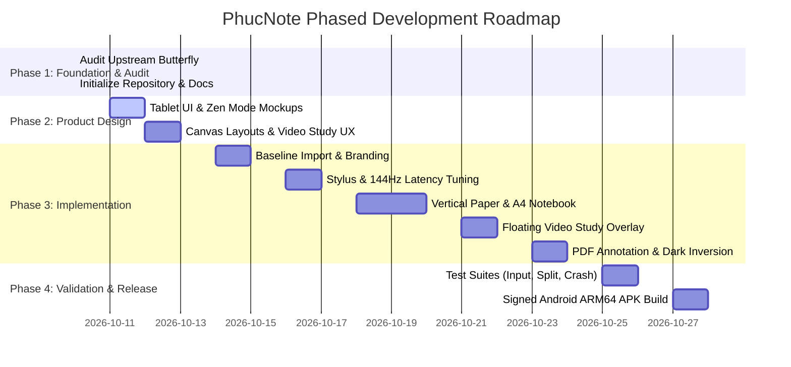

# PhucNote — Development Roadmap & Milestones

**Project:** PhucNote  
**Repository:** [https://github.com/Phuchello/PHUCNOTE](https://github.com/Phuchello/PHUCNOTE)  
**Target Hardware:** Lenovo Legion Y700 Gen 4 (Android ARM64, Lenovo AP501U Stylus)  
**Development Host:** Lenovo ThinkPad X250 (Ubuntu Linux)  

---

## 1. Roadmap Overview & Timeline

The PhucNote roadmap follows an incremental, test-driven engineering discipline. No major source modifications or core replacements occur without passing verification checkpoints.



---

## 2. Phase Breakdown & Acceptance Criteria

### Phase 1 — Repository Audit & Architecture Assessment (Current Phase)
- **Objective:** Complete in-depth audit of Linwood Butterfly v2.6.0, evaluate AGPL-3.0 obligations, analyze Lenovo ThinkPad X250 host limits, design target architecture, and initialize project deliverables.
- **Checkpoints:**
  - `CHECKPOINT-00-AUDIT-BASELINE`: Upstream clean inspection complete.
  - `CHECKPOINT-01-DOCS-INITIALIZED`: Project documentation committed to official repository.
- **Acceptance Criteria:**
  - [x] Full audit report completed.
  - [x] Official deliverables created (`README.md`, `PRODUCT_REQUIREMENTS.md`, `ARCHITECTURE.md`, `DEVELOPMENT_ROADMAP.md`, `LICENSE_AUDIT.md`, `PROJECT_STATE.md`, `TODO.md`).
  - [x] Zero premature modifications to core code.

---

### Phase 2 — Product Design & UI/UX Blueprint
- **Objective:** Create tablet-first design assets and widget hierarchies optimized for the 8.8" display of the Lenovo Legion Y700 Gen 4.
- **Milestones:**
  - **M2.1: Floating Pill Palette:** Ergonomic toolbar with quick pen/color slots, thickness sliders, and auto-docking behaviors.
  - **M2.2: Canvas Layout Specification:** Visual rules for Infinite 2D, Infinite Vertical Paper, and A4 Notebook boundaries.
  - **M2.3: Video Overlay Specification:** Draggable picture-in-picture window with playback controls and lecture bookmark pins.
  - **M2.4: Color & Contrast Schemes:** High-contrast Dark Mode and Warm Paper Ivory for prolonged study sessions.
- **Acceptance Criteria:**
  - Complete widget mockups and layout contracts approved before code integration.

---

### Phase 3 — Incremental Implementation

#### Step 3.1: Clean Baseline Import & Branding Decoupling
- Import audited Butterfly core packages (`butterfly_api`, drawing engine, `.bfly` serializer).
- Replace all Linwood names, logos, app IDs, and asset references with PhucNote branding.
- Enforce AGPL-3.0 notices in headers and license documentation.
- **Checkpoint:** `CHECKPOINT-02-BASELINE-IMPORT`

#### Step 3.2: Stylus & Low-Latency Optimization (up to 165Hz)
- Tune `_ViewportInputCoordinator` to prioritize `PointerDeviceKind.stylus`.
- Calibrate pressure response curves dynamically for the Lenovo AP501U stylus tip.
- Configure Android surface view flags to ensure high refresh rate (up to 165Hz) render loop engagement.
- Map AP501U barrel buttons to instant eraser and lasso selector.
- **Checkpoint:** `CHECKPOINT-03-STYLUS-TUNING`

#### Step 3.3: Notebook & Continuous Vertical Paper Modes
- Implement continuous vertical page stacking in `ViewportCanvas`.
- Implement A4 aspect ratio sheet constraints with auto-paging.
- Add curated paper templates: Ruled (Narrow/Medium), Cornell Notes, Engineering Graph, Dot Matrix.
- **Checkpoint:** `CHECKPOINT-04-PAPER-MODES`

#### Step 3.4: Tablet UI & Zen Distraction-Free Experience
- Build the floating pill toolbar widget.
- Implement 1-tap Zen Mode gesture (double-tap with 2 fingers or edge button) to tuck away all UI chrome.
- Add split-screen responsive transitions for Android multi-window resizing (< 600dp breakpoint).
- **Checkpoint:** `CHECKPOINT-05-TABLET-UI`

#### Step 3.5: Floating Video Study Workflow
- Integrate draggable floating video player overlay.
- Implement pointer pass-through to ensure continuous handwriting while video plays.
- Add lecture timestamp note-linking.
- **Checkpoint:** `CHECKPOINT-06-VIDEO-STUDY`

#### Step 3.6: PDF Import & Export Polish
- Streamline multi-page PDF import into continuous notebook flow.
- Ensure reliable 1:1 vector PDF export with all ink annotations preserved.
- Optimize PDF tile caching to keep RAM under 450MB on large documents.
- **Checkpoint:** `CHECKPOINT-07-PDF-WORKFLOW`

---

---

### Phase 4 — Validation & Android ARM64 Release Build
- **Objective:** Rigorous physical testing and release packaging for the Lenovo Legion Y700 Gen 4.
- **Test Matrix Execution:**
  - Test handwriting latency and jitter under high refresh rate (up to 165Hz).
  - Test palm rejection reliability with active pen on glass.
  - Test split-screen multitasking with YouTube and web browsers.
  - Test large PDF document annotation (50+ pages).
  - Test forced process kill / crash recovery of unsaved notes.
  - Verify complete offline operation in Airplane mode.
- **Build Delivery:**
  - Build signed and debug Android ARM64 APK:
    ```bash
    flutter build apk --release --target-platform android-arm64
    ```
- **Checkpoint:** `CHECKPOINT-08-RELEASE-APK`

---

### Phase 5 — Academic Modules: PHUC ORGANIZER & PHUC TRANSLATE
> [!NOTE]
> **Prerequisite:** Built directly on top of validated core file persistence and `pdfrx` text extraction. Both modules are designed offline-first.

- **Objective:** Deliver the academic course workspace management system, smart ingestion engine, research paper library, and scientific translation engine (EN <-> VI).
- **Milestones:**
  - **M5.1: Organizer Core & Academic Hierarchy:** Academic catalog database (`academic_catalog.db`), workspace switcher, academic year/semester navigation, course dashboards, and color tags.
  - **M5.2: Smart Classification Engine:** Filename heuristic tokenizer, first-page PDF text extraction, and user confirmation routing modal.
  - **M5.3: Research Workspace & Bibliographic Engine:** Paper metadata cards (DOI, BibTeX, authors), literature review notes, and bidirectional PDF coordinate links.
  - **M5.4: Translate Core & Stylus Selection:** Lenovo AP501U stylus highlight selection on canvas text and `pdfrx` text streams; side-by-side and popover translation cards.
  - **M5.5: Scientific Integrity Sanitizer:** Formula, LaTeX, citation (`[1]`), unit, and DOI masking/restoration pipeline.
  - **M5.6: Dual Translation Engines & Local Glossary:** Google ML Kit on-device translation (100% offline) + optional cloud academic translation (BYOK); local SQLite scientific glossary editor.
  - **M5.7: MediaProjection Screen Translation Service:** Permission-gated Android service with system consent, `FLAG_SECURE` enforcement, and memory-only frame processing.
- **Checkpoint:** `CHECKPOINT-09-ORGANIZER-TRANSLATE-SPECS`

---

### Phase 6 — PHUC AI Learning Assistant Extension
> [!IMPORTANT]
> **Prerequisite Rule:** Phase 6 implementation commences after the core handwriting, organizer, and translation modules pass verification on the Lenovo Legion Y700 Gen 4.

- **Objective:** Implement the decoupled multimodal learning assistant, BYOK provider-independent AI integration with dynamic model discovery, handwriting lasso Q&A, and notebook study tools.
- **Milestones:**
  - **M6.1: Decoupled Module & BYOK Security:** Create `lib/features/phuc_ai` boundary; implement Android KeyStore-backed API key storage with `flutter_secure_storage`.
  - **M6.2: Multimodal Handwriting Pipeline:** Integrate in-memory lasso selection crop rasterization and multimodal vision querying.
  - **M6.3: Document Retrieval & Citations:** Implement text chunking for active PDF and note pages with structured coordinate citations.
  - **M6.4: Academic Study Tool Actions:** Build 1-tap quick actions (Explain, Summarize, 5-Question Quiz, Flashcards, Insert answer to canvas).
  - **M6.5: Tablet-First UI & Video Coexistence:** Implement floating AI chat window and collapsible dockable side panel optimized for 8.8" display alongside floating video player.
  - **M6.6: Gemini Notebook Bridge:** Build the 1-tap NotebookLM course export bridge and optional Gemini Notebook Enterprise connector.
- **Checkpoint:** `CHECKPOINT-10-PHUCAI-INTEGRATED`

---

## 3. Git Workflow & Branching Discipline

1. **`main` Branch:** Protected production-ready branch. Every merge must have a passing test record.
2. **`develop` Branch:** Working integration branch for Phase 2, 3, and 4.
3. **Feature Branches (`feat/*`, `fix/*`):**
   - `feat/branding-decouple`
   - `feat/stylus-calibration`
   - `feat/vertical-paper`
   - `feat/video-overlay`
   - `feat/tablet-ui`
   - `feat/phuc-organizer`
   - `feat/phuc-translate`
   - `feat/phuc-ai-assistant` (conditioned on Phase 4 passing)
4. **Pull Requests:** Substantial changes will be bundled into pull requests with automated commit checkpoints and changelog updates.
