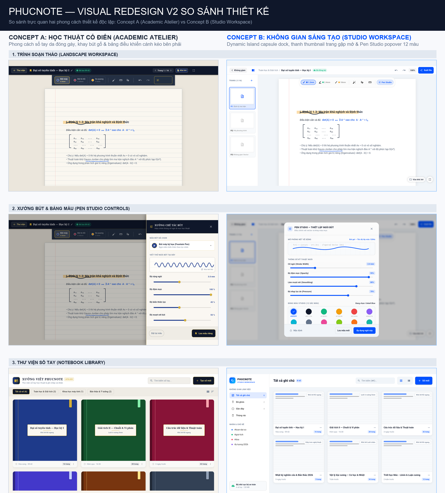

# PHUCNOTE — VISUAL REDESIGN V2 REVIEW

**Repository:** [Phuchello/PHUCNOTE](https://github.com/Phuchello/PHUCNOTE)  
**Branch:** `develop`  
**Date:** 11/10/2026  
**Status:** Completed Prototypes for Independent Design Review  

---

## 1. Executive Summary

Visual Redesign V2 explores two fundamentally distinct design directions for the PHUCNOTE tablet experience, replacing the generic default Material 3 styling with cohesive, purpose-built digital stationery identities:

- **Concept A (Academic Atelier / Xưởng Viết Học Thuật):** A tactile, bookbound aesthetic inspired by classic European academic stationery, Oxford cloth bindings, physical pen trays, and a collapsible right-side tuning panel.
- **Concept B (Studio Workspace / Không Gian Sáng Tạo):** A high-productivity modern minimalist studio inspired by professional tablet workspaces, featuring an architectural breadcrumb header, collapsible left page rail, a Dynamic Island floating frosted capsule dock, and an unclipped floating Pen Studio popover with 12 distinct color wells.

Both concepts have been prototyped, fully localized into Vietnamese, executed on a real Android tablet emulator (`medium_tablet`, 2560×1600), and captured without layout clipping or `RenderFlex` overflow.

---

## 2. Side-by-Side Visual Comparison

The consolidated side-by-side comparison below highlights the direct visual contrast across Editor Workspaces, Pen Studio Controls, and Notebook Libraries:

> Direct repository link: [artifacts/visual-redesign-v2/COMPARISON.png](https://github.com/Phuchello/PHUCNOTE/blob/develop/artifacts/visual-redesign-v2/COMPARISON.png)

---

## 3. Prototype Evidence Catalog (10 Verified Screenshots)

All screenshots were captured live via Flutter Driver on Android API 35 (`medium_tablet`).

### Concept A — Academic Atelier (Xưởng Viết Học Thuật)

| View | Screenshot Preview & Link | Key Visual Features |
| :--- | :--- | :--- |
| **Thư viện sổ tay (Library)** | [concept_a_library.png](artifacts/visual-redesign-v2/concept_a_library.png) | Bound leather notebooks with ribbon markers, academic category tabs, warm cream paper background. |
| **Trình soạn thảo ngang (Landscape Editor)** | [concept_a_landscape_editor.png](artifacts/visual-redesign-v2/concept_a_landscape_editor.png) | Oxford navy header with gold bookmark badge, 3-slot wooden desk pen tray, bound A4 sheet with subtle margin rules. |
| **Trình soạn thảo đứng (Portrait Editor)** | [concept_a_portrait_editor.png](artifacts/visual-redesign-v2/concept_a_portrait_editor.png) | Responsive desk tray adaptation, clean title truncation with ellipsis, centered A4 canvas. |
| **Xưởng chế tác bút (Pen Studio Drawer)** | [concept_a_pen_studio.png](artifacts/visual-redesign-v2/concept_a_pen_studio.png) | Right-anchored tuning drawer panel with brass/gold slider accents, live dynamic waveform, preset selection. |
| **Giao diện tối (Dark Editor)** | [concept_a_dark_editor.png](artifacts/visual-redesign-v2/concept_a_dark_editor.png) | Midnight Oxford chalkboard slate with white ink/chalk contrast and golden accents. |

### Concept B — Studio Workspace (Không Gian Sáng Tạo)

| View | Screenshot Preview & Link | Key Visual Features |
| :--- | :--- | :--- |
| **Không gian làm việc (Library)** | [concept_b_library.png](artifacts/visual-redesign-v2/concept_b_library.png) | Collapsible navigation rail with tags and local storage quota indicator; document cards with simulated page previews. |
| **Trình soạn thảo ngang (Landscape Editor)** | [concept_b_landscape_editor.png](artifacts/visual-redesign-v2/concept_b_landscape_editor.png) | Architectural breadcrumb header, collapsible left page thumbnails rail, top-centered Dynamic Island floating capsule dock. |
| **Trình soạn thảo đứng (Portrait Editor)** | [concept_b_portrait_editor.png](artifacts/visual-redesign-v2/concept_b_portrait_editor.png) | Clean responsive collapse of thumbnail rail into icon button, centered floating dock, zero overflow. |
| **Xưởng bút Studio (Pen Studio Popover)** | [concept_b_pen_studio.png](artifacts/visual-redesign-v2/concept_b_pen_studio.png) | Floating frosted glass modal with 12 unclipped color wells (6 academic + 6 studio accents), 4 precision sliders with numerical badges, hex input. |
| **Giao diện tối (Dark Editor)** | [concept_b_dark_editor.png](artifacts/visual-redesign-v2/concept_b_dark_editor.png) | Titanium Dark surface (`#090B10`, `#11141C`) with Electric Cobalt accents (`#0052FF`) and high WCAG contrast. |

---

## 4. In-Depth Architectural Comparison

| Dimension | Concept A (Academic Atelier) | Concept B (Studio Workspace) |
| :--- | :--- | :--- |
| **Core Metaphor** | Classic leather-bound academic journal & scholar's wooden desk tray. | Modern digital studio workspace & floating dynamic island dock. |
| **Color Palette** | Deep Oxford Navy (`#1A2536`), Warm Amber/Gold (`#D97706`), Warm Ivory Paper (`#FBF9F5`). | Electric Cobalt (`#0052FF`), Titanium Dark (`#090B10`), Cool Slate (`#F1F5F9`), Crisp White (`#FFFFFF`). |
| **Toolbar Architecture** | Segmented desk tray pinned below header with 3 preset pen slots (`Bút máy`, `Bút bi đỏ`, `Dạ quang`). | Floating Dynamic Island capsule dock (`r=24px`) hovering above canvas with quick tool switching. |
| **Document Navigation** | Traditional page switcher in header (`Trang 1 / 16`). | Collapsible left thumbnail rail with live visual page previews and quick page management. |
| **Pen Studio Surface** | Right-anchored side drawer slide-over (`width: 440px`). | Centered floating frosted glass popover modal (`maxWidth: 580px`, `r=20px`). |
| **Color Palette Well Count** | 6 Classic academic ink wells inside drawer. | 12 Unclipped color wells (6 Academic + 6 Studio accents) in a dedicated card. |
| **Defect Resolution** | Avoids clipping by using vertically scrollable drawer. | Completely resolves sliced swatches via spacious `Wrap` layout and compact vertical density. |
| **Screen Space Efficiency** | Medium: Pinned header + desk tray takes fixed vertical budget (`~120px`). | High: Floating capsule dock overlays canvas, maximizing vertical writing space. |

---

## 5. Strengths & Weaknesses

### Concept A: Academic Atelier
- **Strengths:**
  - Distinctive, tactile personality with high nostalgic and scholastic warmth.
  - Clear notebook metaphor appeals strongly to students, researchers, and long-form journalers.
  - Pinned desk tray makes switching between 3 predefined pens feel like picking physical stationery from a tray.
- **Weaknesses:**
  - Pinned desk tray reduces vertical writing canvas height on smaller tablets or split-screen modes.
  - Right-side drawer covers a large horizontal portion of the writing canvas when open.
  - Less adaptable if a user works with more than 3 active pen styles simultaneously.

### Concept B: Studio Workspace
- **Strengths:**
  - Modern, minimalist, and highly spacious; feels on par with premium digital note-taking apps.
  - Floating Dynamic Island capsule dock occupies minimal screen real estate and stays out of the way.
  - Collapsible left page thumbnail rail significantly improves multi-page navigation and visual scanning.
  - Floating Pen Studio popover features 12 spacious, unclipped color wells and precision numerical badges with zero clipping.
  - Highly responsive across landscape, portrait, and narrow tablet split-views.
- **Weaknesses:**
  - More technical/digital feel compared to the warm, bound-leather aesthetic of Concept A.

---

## 6. Recommendation

**Recommendation: CONCEPT B (PHUCNOTE Studio Workspace)**

While Concept A offers a warm academic atmosphere, **Concept B is the superior choice for PHUCNOTE's ongoing evolution**:
1. **Ergonomic Writing Space:** The floating capsule dock leaves significantly more unencumbered canvas area for natural stylus writing.
2. **Superior Page Organization:** The collapsible thumbnail rail directly addresses multi-page notebook navigation.
3. **Flawless Pen Studio:** Concept B's popover layout completely eliminates the sliced color swatch defect, providing immediate access to 12 vivid inks and numerical parameter badges.
4. **Modern Scalability:** The breadcrumb header and clean studio tokens seamlessly scale to future features (such as tags, folders, and multi-notebook management).

---

## 7. Isolated Review Assets Inventory

All prototype files are completely decoupled from production code and reside under:
- `lib/design_preview/`:
  - `preview_app.dart` (Stand-alone preview runner)
  - `mock_data.dart` (Sample Vietnamese academic notes and metadata)
  - `concept_a/`: `concept_a_library_view.dart`, `concept_a_editor_view.dart`, `concept_a_studio_view.dart`
  - `concept_b/`: `concept_b_library_view.dart`, `concept_b_editor_view.dart`, `concept_b_studio_view.dart`
- `integration_test/capture_visual_redesign_v2.dart` (Flutter Driver automated capture suite)
- `test_driver/visual_redesign_v2_driver.dart` (Driver writing PNGs to `artifacts/visual-redesign-v2/`)
- `artifacts/visual-redesign-v2/`: 10 prototype PNGs + `COMPARISON.png`
