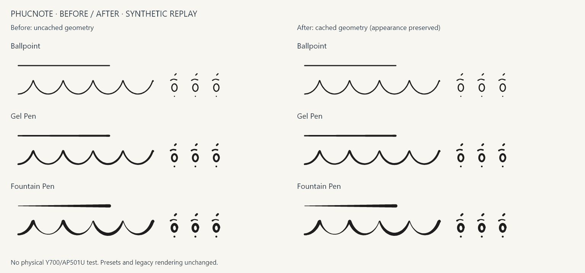

# Three pen candidates — provisional review

These are the three existing CP-10 pen presets, not a newly certified flagship
engine. No preset values or saved style interpretation changed in this checkpoint.
All strokes still capture their exact style at pointer-down.

The inspected image uses StrokeGeometry itself, a synthetic pressure ramp, tight
curves, oval/hat/acute/dot components and identical input on both sides. Its trace
is `artifacts/y700-gen4-ink/pen_trace.json`; the renderer is the focused comparison
test. Labels use the existing Windows Segoe UI font on this workstation. This is
not a photograph or handwriting collected from AP501U. Before means uncached;
after means cached. Identical appearance is the required optimization outcome.

| Candidate | Width / thinning / smoothing / streamline | Observed replay appearance |
|---|---|---|
| Ballpoint | 3 / 0 / 0.5 / 0.35 | Uniform ramp width, narrow curves, separated accent parts |
| Gel Pen | 4.5 / 0.2 / 0.7 / 0.55 | Fuller curves, mild pressure-width variation, round caps |
| Fountain Pen | 5 / 0.8 / 0.55 / 0.4 | Strong ramp variation and heavier pressure peaks; round caps |

**Ballpoint is the provisional choice for small marks**, because zero thinning
keeps width stable and the narrow preset leaves more separation. This conclusion
applies to replay samples only. Best pen for Y700/AP501U is **UNDETERMINED**.
The automated existing geometry test independently checks measurable differences
between all three presets and variable versus constant-width pressure response.

Gel and Fountain do not become better handwriting merely because they are wider.
Synthetic ramp variation is not AP501U calibration. Constant-pressure simulation,
the 0.1 capture floor and nominal-width dots remain disclosed limitations.
Fountain is a soft-nib width simulation, not true nib-angle/calligraphy geometry.
Independent start/end taper is not implemented: introducing a new interpretation
without a persisted discriminator would silently change legacy ink. This
subfeature is blocked by compatibility constraints and was stopped.

## Physical comparison status

All Y700/AP501U exercises and competitor-app comparisons: **NOT EXECUTED**.
App availability must be verified on the actual device. For each functioning app,
record its version/settings/zoom/orientation/observed refresh; use the same author,
pen and two five-minute scripts (rapid lecture notes; small Vietnamese with
ă/â/ê/ô/ơ/ư, all tone marks and đ). Include pressure ramps, curves/loops, formulas,
diagrams, palm contact, zoom, long strokes, undo/redo and save/reopen. Preserve
screenshots, native/Flutter traces and external high-speed video when possible.
Compare visible missing/spurious strokes, accent separation, cap/connection blobs,
completed-stroke stability and long-session degradation. Report disadvantages too.

No emulator result substitutes for these physical gates. Full acceptance and a
claim of flagship pen quality remain blocked by unavailable target hardware.
